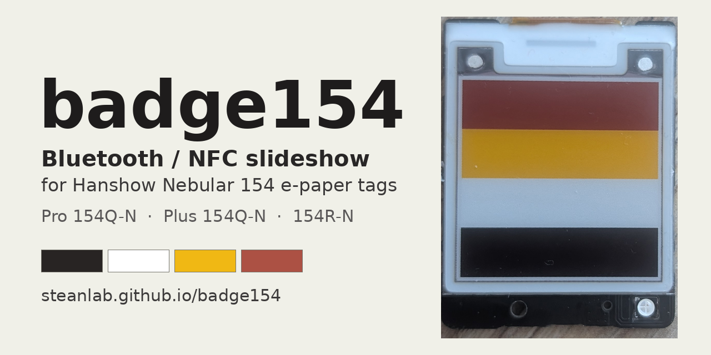

# badge154

 [-blue)](LICENSE)

A standalone e-paper slideshow for the **Hanshow Nebular 154** electronic shelf labels (**Pro 154Q-N, Plus 154Q-N and 154R-N**; one firmware, tested on all three): 1.54", 200 x 200 px,
black / white / yellow / red, Telink TLSR8359. The slides live in the flash of the tag and are uploaded from a phone or a
computer over Bluetooth with a web page. The picture stays on the e-paper without power.

**Control page:** https://steanlab.github.io/badge154/ (Chrome on Android or on a computer; installable as an app, works offline after the first visit)

> Flashing **replaces the original firmware** of the tag. Back up the stock flash first (see [`firmware/FLASHING.md`](firmware/FLASHING.md)).
> Use at your own risk, no warranty. Unofficial: not affiliated with Hanshow, Telink or OpenEPaperLink.

## Compatible tags

One firmware for the whole Nebular 154 family. Tested on all three variants:

| Label on the housing | Board marking | Power | FCC ID printed | Status |
|---|---|---|---|---|
| `Model: Nebular Pro-154Q-N` | `HSEL4Q_01_54M_31` | soft (pouch) cell, 650 mAh, soldered | 2AYMH-NP-154 | tested |
| `Model: Nebular Plus-154Q-N` | `HSEL4Q_01_54M_31` | coin cell, "Hanshow Lithium Battery" | 2AYMH-NP-154Q | tested |
| `Model: Nebular-154R-N` | `HSEL4_01_54M_30` | soft (pouch) cell, 650 mAh, soldered | not printed | tested |

All three: Telink TLSR8359 (marked Hanshow HS9118), 512 KB flash, 1.54" 200 x 200 black / white / yellow / red panel, NFC chip FM11NT083V, RGB LED. Photos of the boards and the programming pads: [`docs/HARDWARE.md`](docs/HARDWARE.md#hardware-variants). Other Hanshow tags are **not** supported.

Have a different tag, or a result from one of these? Open an Issue and say what worked.

## What it does

- Stores up to 98 blocks of slides (4 KB each) in the internal flash. Every slide is compressed (raw, LZ4, 1 bit per pixel, or 1 bit + LZ4: the smallest wins) and
  protected by a CRC: a slide becomes visible only after the tag has checked it.
- Changes slides by itself every N minutes (0 = off), in order or at random. **An NFC tap with a phone changes to the next slide.**
- The page prepares pictures: fit / crop, rotate, mirror, contrast, gamma, dithering to the four ink colours or to black and white.
- Shows the slides on the tag; show, delete, previous / next, delete all.
- A **name** for each tag (shown in the Bluetooth list as `badge154-<name>`), so several tags can be told apart.
- **Hardware report** (battery, uptime, memory, flash, chip temperature, link, radio power) on the page or on the tag screen.
- Adjustable radio power, a watchdog that restarts a hung tag, and a low-battery mode that stops flash writes and panel refreshes before the voltage collapses.

Everything the tag does and what its light signals mean: the [user guide](docs/USAGE.md).

## Quick start

1. Download `badge154-firmware-<version>.bin` from the [Releases](https://github.com/steanlab/badge154/releases) page (a copy of the latest is in [`firmware/`](firmware)) and flash it over a USB-UART adapter ([`firmware/FLASHING.md`](firmware/FLASHING.md)). Check the file against `SHA256SUMS.txt`.
2. Open the control page in Chrome (Android, Windows, macOS, Linux). iPhone: Safari has no Web Bluetooth.
3. **Connect** and pick `badge154-...` in the list.
4. Choose pictures, check the preview, **Upload to the tag**; then press **show** next to a slide (a panel refresh takes about 25 s).
5. Set the interval and the order, **Save to tag**.

## What is verified

Verified on real tags (the firmware on all three variants): the panel driver, upload (about 0.6 KB/s, so a photo takes 10 to 15 s), storage, show, delete, automatic change, NFC tap, LED, tag name,
watchdog, hardware report (including the unique flash ID and the MAC address).
Implemented and tested on a host emulator, **not yet verified on the tag**: the exact low-battery thresholds and
the effect of each radio power level. Not measured at all: battery voltage scale against a multimeter, sleep current, panel temperature scale,
long-term behaviour. See [`docs/HARDWARE.md`](docs/HARDWARE.md).

## Repository

| Path | What |
|---|---|
| `docs/index.html` | the control page (GitHub Pages) and the installable-app files |
| [`docs/USAGE.md`](docs/USAGE.md) | user guide: what the tag does, light signals, screens, troubleshooting |
| [`docs/PROTOCOL.md`](docs/PROTOCOL.md) | the Bluetooth protocol and the stored slide format |
| [`docs/HARDWARE.md`](docs/HARDWARE.md) | everything found out about the tag for people who write their own firmware: pins, flash, panel sequence, NFC, battery, Bluetooth limits, and how sure each fact is |
| [`firmware/FLASHING.md`](firmware/FLASHING.md) | how to back up the stock flash and flash the firmware, first checks, restarting the tag |
| `firmware/` | the released firmware file with its SHA-256 sum |

## Credits and licence

The control page and the documents are under the MIT licence, see [`LICENSE`](LICENSE). The firmware file is free to use on your own tags, without any warranty.
**The source code of the firmware is not published.** It builds on atc1441's [ATC_TLSR_Paper](https://github.com/atc1441/ATC_TLSR_Paper); the panel information was
read from atc1441's ATC_BLE_OEPL. Third-party licences and provenance: [`NOTICE.md`](NOTICE.md).
Questions, reports and test results from other tags are welcome in the Issues.
A similar project for another tag: [badge27](https://github.com/steanlab/badge27).
