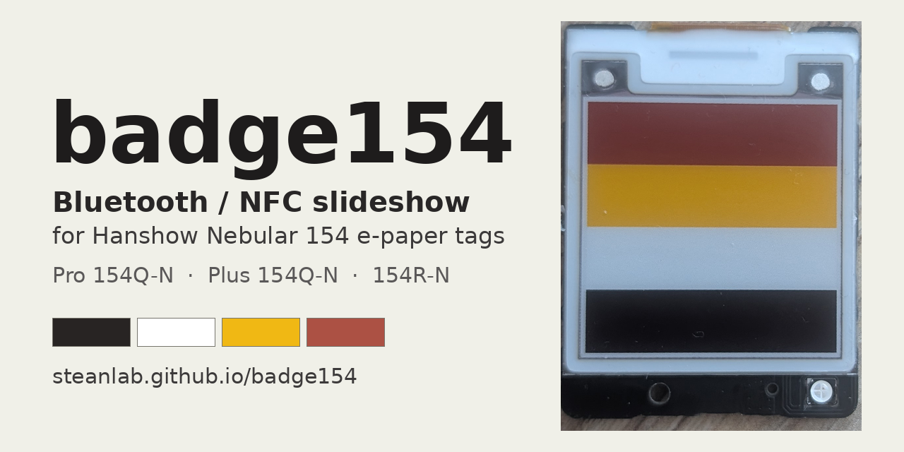

# badge154

**Язык:** [English](README.md) · Русский

 [-blue)](LICENSE)

Автономное слайдшоу на электронных ценниках **Hanshow Nebular 154** (**Pro 154Q-N, Plus 154Q-N и 154R-N**; одна прошивка, проверена на всех трёх): экран 1,54", 200 × 200 точек,
чёрный / белый / жёлтый / красный, процессор Telink TLSR8359. Слайды лежат во флеш-памяти метки и загружаются с телефона или компьютера по Bluetooth через веб-страницу. Картинка на экране остаётся без питания.

**Страница управления:** https://steanlab.github.io/badge154/ (Chrome на Android или на компьютере; ставится как приложение, после первого открытия работает без интернета)

> Прошивка **заменяет оригинальную прошивку** метки. Сначала сделайте резервную копию заводской флеш-памяти (см. [`firmware/FLASHING.md`](firmware/FLASHING.md)).
> Используйте на свой риск, без гарантий. Неофициальный проект: не связан с Hanshow, Telink и OpenEPaperLink.

Документация (руководство, протокол, описание железа) написана по-английски.

## Какие метки подходят

Одна прошивка для всего семейства Nebular 154. Проверено на всех трёх вариантах:

| Надпись на корпусе | Маркировка платы | Питание | FCC ID на корпусе | Статус |
|---|---|---|---|---|
| `Model: Nebular Pro-154Q-N` | `HSEL4Q_01_54M_31` | мягкий (pouch) аккумулятор 650 мАч, впаян | 2AYMH-NP-154 | проверено |
| `Model: Nebular Plus-154Q-N` | `HSEL4Q_01_54M_31` | таблетка «Hanshow Lithium Battery» | 2AYMH-NP-154Q | проверено |
| `Model: Nebular-154R-N` | `HSEL4_01_54M_30` | мягкий (pouch) аккумулятор 650 мАч, впаян | не указан | проверено |

У всех трёх: Telink TLSR8359 (маркировка Hanshow HS9118), флеш 512 КБ, панель 1,54" 200 × 200 чёрный / белый / жёлтый / красный, NFC-чип FM11NT083V, RGB-светодиод. Фото плат и площадок для прошивки: [`docs/HARDWARE.md`](docs/HARDWARE.md#hardware-variants). Другие метки Hanshow **не** поддерживаются.

Есть другая метка или результат на одной из этих? Откройте Issue и напишите, что сработало.

## Что умеет

- Хранит до 98 блоков слайдов (по 4 КБ) во внутренней флеш-памяти. Каждый слайд сжимается (без сжатия, LZ4, 1 бит на точку или 1 бит + LZ4: выбирается самый маленький) и
  защищён контрольной суммой: слайд становится видимым только после проверки меткой.
- Меняет слайды сама каждые N минут (0 = выключено), по порядку или случайно. **Касание телефоном (NFC) показывает следующий слайд.**
- Страница готовит картинки: вписать или обрезать, повернуть, зеркало, контраст, гамма, дизеринг в четыре цвета панели или в чёрно-белое.
- Показ слайдов на метке: показать, удалить, назад / вперёд, удалить все.
- **Имя** для каждой метки (в списке Bluetooth виден как `badge154-<имя>`), чтобы различать несколько меток.
- **Отчёт о железе** (батарея, время работы, память, флеш, температура чипа, связь, мощность радио) на странице или на экране метки.
- Настраиваемая мощность радио, сторожевой таймер, перезапускающий зависшую метку, и режим низкого заряда, который останавливает запись и обновление панели раньше, чем напряжение просядет.

Всё, что делает метка, и что означают световые сигналы: [руководство](docs/USAGE.md) (по-английски).

## Быстрый старт

1. Скачайте `badge154-firmware-<версия>.bin` на странице [Releases](https://github.com/steanlab/badge154/releases) (копия последней лежит в папке [`firmware/`](firmware)) и прошейте через USB-UART адаптер ([`firmware/FLASHING.md`](firmware/FLASHING.md)). Сверьте файл с `SHA256SUMS.txt`.
2. Откройте страницу управления в Chrome (Android, Windows, macOS, Linux). iPhone: в Safari нет Web Bluetooth.
3. **Connect** и выберите `badge154-...` в списке.
4. Выберите картинки, проверьте предпросмотр, **Upload to the tag**; затем нажмите **show** у слайда (обновление панели занимает около 25 с).
5. Задайте интервал и порядок, **Save to tag**.

## Что проверено

Проверено на реальных метках (прошивка на всех трёх вариантах): драйвер панели, загрузка (около 0,6 КБ/с, фото занимает 10–15 с), хранение, показ, удаление, автоматическая смена, касание NFC, светодиод, имя метки,
сторожевой таймер, отчёт о железе (включая уникальный ID флеша и MAC-адрес).
Сделано и проверено на эмуляторе, **но не проверено на метке**: точные пороги низкого заряда и
действие каждого уровня мощности радио. Совсем не измерено: шкала напряжения батареи по мультиметру, ток сна, шкала температуры панели,
долговременная работа. См. [`docs/HARDWARE.md`](docs/HARDWARE.md).

## Что в репозитории

| Путь | Что |
|---|---|
| `docs/index.html` | страница управления (GitHub Pages) и файлы для установки как приложения |
| [`docs/USAGE.md`](docs/USAGE.md) | руководство: что делает метка, световые сигналы, экраны, неполадки |
| [`docs/PROTOCOL.md`](docs/PROTOCOL.md) | протокол Bluetooth и формат слайда во флеше |
| [`docs/HARDWARE.md`](docs/HARDWARE.md) | всё, что выяснено о метке, для тех, кто пишет свою прошивку: выводы, флеш, последовательность работы панели, NFC, батарея, ограничения Bluetooth и степень уверенности по каждому факту |
| [`firmware/FLASHING.md`](firmware/FLASHING.md) | как сделать резервную копию заводской прошивки и прошить, первые проверки, перезапуск метки |
| `firmware/` | выпущенный файл прошивки и его контрольная сумма SHA-256 |

## Авторство и лицензия

Страница управления и документы под лицензией MIT, см. [`LICENSE`](LICENSE). Файл прошивки можно бесплатно использовать на своих метках, без каких-либо гарантий.
**Исходный код прошивки не публикуется.** Прошивка построена на проекте atc1441 [ATC_TLSR_Paper](https://github.com/atc1441/ATC_TLSR_Paper); сведения о панели получены из ATC_BLE_OEPL atc1441. Лицензии сторонних компонентов и происхождение: [`NOTICE.md`](NOTICE.md).
Вопросы, отчёты и результаты на других метках приветствуются в Issues.
Похожий проект для другой метки: [badge27](https://github.com/steanlab/badge27).
