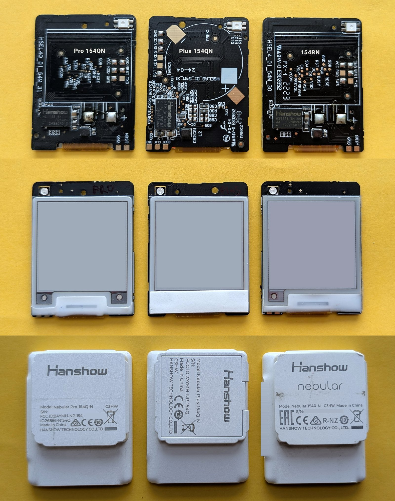
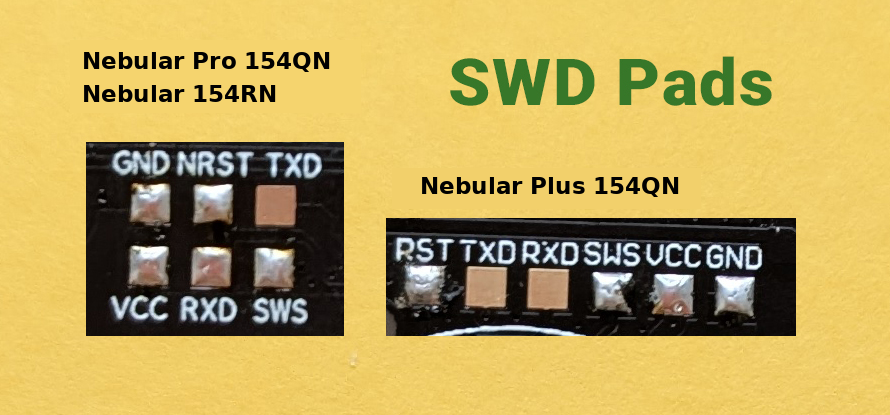
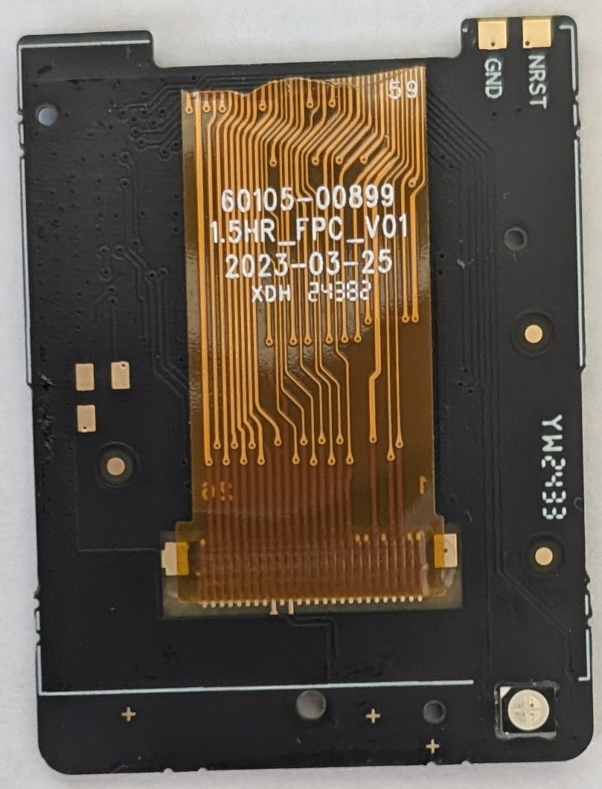
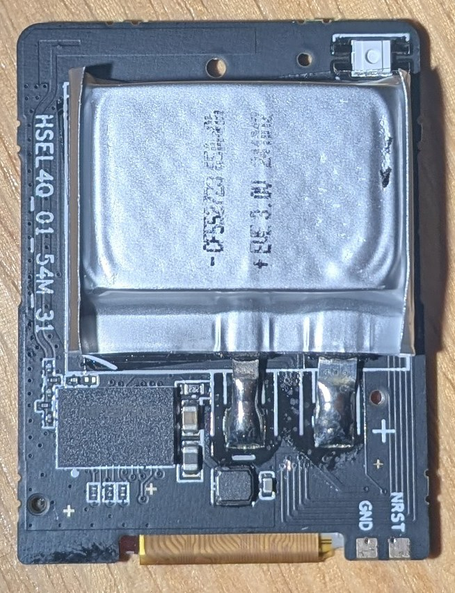
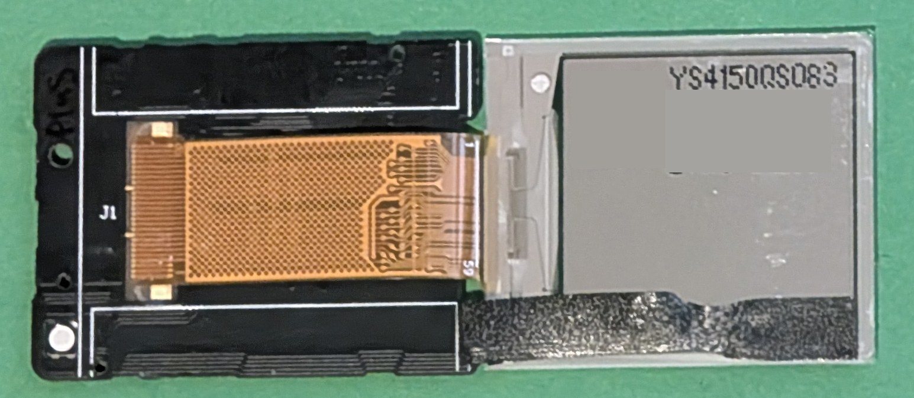

# Hardware notes: Hanshow Nebular 154 (Pro 154Q-N, Plus 154Q-N, 154R-N)

Everything that was found out about this tag family while writing badge154, for anyone who wants to write their own firmware for it.
Unless a variant is named, a fact was observed on the **Pro 154Q-N**; the three variants differ only in the power supply and the board layout (see [Hardware variants](#hardware-variants)).
Every statement carries one of three levels:

- **verified**: seen working on a real tag in this project,
- **from firmware**: taken from the disassembly of the published firmware ATC_BLE_OEPL (preset "38: 200 HS BWRY JD") or from the upstream sources, not independently measured,
- **unknown**: not checked.

The tag is identified as 154QN, hardware ID 0x006C in the OpenEPaperLink tag-type table (from firmware).
The only marked chip that was visible on the board is "HANSHOW 9118"; the board has no other large ICs, and the firmware's pin configuration shows no external flash or EEPROM (from firmware, consistent with everything below).

## Hardware variants

The Nebular 154 comes in three variants. They share the processor, the flash, the panel and the firmware; they differ in how the tag is powered and in the board layout. **Verified by the author: the same badge154 firmware was written to all three variants and works on all three.** The detailed checks (voltage scale, timings, panel colours) were made on the Pro only.

| | Nebular Pro 154Q-N | Nebular Plus 154Q-N | Nebular 154R-N |
|---|---|---|---|
| Label on the housing | `Model: Nebular Pro-154Q-N` | `Model: Nebular Plus-154Q-N` | `Model: Nebular-154R-N` |
| Board marking (silkscreen, read from photographs) | `HSEL4Q_01_54M_31` | `HSEL4Q_01_54M_31` | `HSEL4_01_54M_30` |
| Chip marking | `Hanshow HS9118 ...` | `Hanshow HS9118 ...` | `Hanshow HS9118 ...` (the codes after the name differ between the boards: a revision code, not examined) |
| Programming pads | six, in two rows of three: GND, NRST, TXD / VCC, RXD, SWS | six in one row: RST, TXD, RXD, SWS, VCC, GND (a different layout) | the same as the Pro |
| Power | soft (pouch) cell, 650 mAh, soldered | coin cell, marked "Hanshow Lithium Battery" | soft (pouch) cell, 650 mAh, soldered |



*Top row: the boards (Pro, Plus, 154RN). Middle: the panel side. Bottom: the housings.*



*The six pads. Left: Pro and 154RN (two rows). Right: Plus (one row). The signals are the same, their order and positions are not.*

- The Pro and the 154RN also have separate GND and NRST pads near the bottom edge of the board; the Plus has further pads marked BOOT, CLK and DIO whose function is **unknown** (not examined).
- The cell chemistry and the voltage behaviour of the two cell types under the load of a panel refresh were **not** examined; the low-battery thresholds below were chosen for the Pro and are untried on the others.
- The unique data of every tag (MAC, calibration) are in its own flash: **never flash a dump taken from another tag.**



*The back of the board with the panel flex cable (marking `1.5HR_FPC_V01`).*



*The soldered pouch cell of the Pro.*



*The label of the panel; the model is `YS4150QS083`. The code and the QR code were covered on purpose.*

## Quick facts

| | |
|---|---|
| SoC | Telink TLSR8359 (the TLSR8258 family: 32-bit TC32 core, BLE 5 radio). Verified: runs firmware built with the TLSR8258 SDK |
| Clock | CPU 24 MHz from the crystal (`CLOCK_SYS_CLOCK_HZ`); the system timer ticks at 16 MHz (`CLOCK_16M_SYS_TIMER_CLK_1MS` = 16000) |
| Flash | 512 KB, internal. Verified: the chip is read, erased and written by the firmware; MAC and calibration are in it |
| RAM | 64 KB SRAM from 0x840000. Deep-retention sleep keeps only the lower 32 KB (`DEEPSLEEP_MODE_RET_SRAM_LOW32K`) |
| Panel | 1.54", 200 x 200, four colours (black, white, yellow, red), controller of the "JD" family, full refresh about 25 s |
| NFC | FM11NT083V on I2C (address 0xAE) with an IRQ pin |
| LED | one RGB LED, three separate pins, active low |
| Battery | measured through the SoC's VBAT mode on PB3; the upstream percent scale maps 2.2 V to 0 % and 3.1 V to 100 % |
| Programming | wired UART boot loader on SWS/RST pads; verified with the WebSerial flasher of atc1441. Reading the flash (backup) works through the SWS pad with [hanshow-rp2040-programmer](https://github.com/gerard780/hanshow-rp2040-programmer): verified for dumping on all three variants |
| Toolchain | Telink `tc32` GCC 4.5.1 (shipped with the upstream repository; 32-bit x86 binary, needs i386 libraries on a 64-bit Linux) |

## Pins

| Function | Pin | Notes |
|---|---|---|
| Panel RESET | PD4 | |
| Panel DC (data / command) | PB7 | |
| Panel BUSY | PA1 | **high = idle, low = busy** (verified: refresh completes) |
| Panel CS | PD2 | pulsed low for every single byte, command or data |
| Panel CLK | PD7 | software SPI (bit-banged), MSB first |
| Panel MOSI | PB6 | also an input for the 2-byte read after command 0x40 |
| Panel power ENABLE | PB5 | **driven low = panel powered**; when off it is an input with a 1 MΩ pull-up (verified) |
| LED red / green / blue | PB4 / PD3 / PA7 | active low (verified: all three colours light). Only PB4 and PD3 can use hardware PWM |
| Battery ADC | PB3 | used through the SoC's VBAT mode (`adc_vbat_init(GPIO_PB3)`) |
| NFC SDA / SCL | PC0 / PC1 | I2C |
| NFC CS | PC6 | low during access, high otherwise (verified) |
| NFC IRQ | PC4 | idles high, low on an event (verified) |
| UART of the upstream firmware | RXD PA0, TXD PB1 | not used by badge154 |
| Programming pads | SWS, NRST | SWS to TXD of a USB-UART adapter, NRST to DTR (verified) |

## Flash

512 KB chip. Map used by badge154:

| Address | Use |
|---|---|
| 0x00000 - 0x13FFF | firmware (about 75 KB now; the build fails if it grows past 0x14000) |
| 0x14000 - 0x75FFF | slides: 98 sectors of 4 KB |
| 0x76000 - 0x77FFF | **do not touch**: MAC address and calibration data (Telink convention; the SDK reads the MAC from `CFG_ADR_MAC`) |
| 0x78000 - 0x78FFF | settings sector of the upstream firmware (it writes at 0x78100) |
| 0x79000 | slideshow settings: one 32-byte record (magic, interval, order, flags, radio power, name length and check, name) |

- API: `flash_read_page`, `flash_write_page` (at most 256 bytes, must not cross a 256-byte page), `flash_erase_sector` (4 KB). Writes only clear bits: erase before write. `flash_erase_sector` clears the watchdog.
- **The flash is not readable while it is being programmed** (the code runs from it, XIP). So the source buffer of a flash write must be in RAM, and every function that talks to the flash chip (JEDEC ID, unique ID, ...) must run from RAM and must not be inlined into code that runs from flash. Two bugs in this project came from exactly this: deleting a slide did nothing (the data to write was a `const` in flash), and reading the unique ID froze the tag (an inlined RAM function ran from flash).
- Never mass-erase: the MAC address and the calibration data live in the same flash. Back up the stock flash before the first write and never publish the dump: it contains the individual data of your tag, and the stock firmware is the property of its maker. Dumps are not distributed here.
- A Telink OTA image would be written at 0x20000, i.e. over the slides, so OTA is removed in badge154.
- The JEDEC ID (3 bytes) and the 16-byte unique ID of the flash chip are read with the standard commands 0x9F and 0x4B (0x5A for some vendors); the unique ID identifies the individual tag and should not be published.

## RAM and sleep

- Variables that must survive deep-retention sleep need the `RAM` attribute (section `.retention_data`). Ordinary statics and `.bss` are not kept. The retention section ends at about 0x8464E4 and may grow up to 0x848000.
- badge154 ends its `.bss` at about 0x84B335 (limit used in CI: 0x84F000, to leave a stack of at least 4 KB; the stack starts at 0x850000 and grows down). A build check enforces it.
- Sleep: `SUSPEND_ADV | DEEPSLEEP_RETENTION_ADV | SUSPEND_CONN | DEEPSLEEP_RETENTION_CONN`; retention threshold 95, early wake-up 240. The longest sleep is about 1 s (advertising interval 1 s), so the main loop runs at least about once a second.
- Functions that must stay available during and after sleep carry `_attribute_ram_code_`. After a wake-up from deep retention `user_init_deepRetn` runs: the radio power and the watchdog must be set again there.
- During a panel refresh the main loop disables CPU suspend (it polls BUSY).
- Time: `get_time()` counts seconds from the system timer with a trim constant (`time_trime`, upstream default 5000). Accuracy over hours is **unknown**. The upstream catch-up `if` was changed to `while`, otherwise the time falls behind when the main loop is late.
- A watchdog is available (`wd_set_interval_ms`, `wd_clear`, `wd_start`). The upstream firmware never enables it. badge154 uses 8 s and feeds it at the top of the main loop (verified by a deliberate hang). Analog registers 0x3a / 0x3b survive a watchdog reset and are used for a restart counter.

## Battery and sensors

- Battery voltage: `adc_vbat_init(GPIO_PB3)` then `adc_sample_and_get_result()` returns millivolts. **The scale has not been compared with a multimeter.** Percent in the upstream code: `(mV - 2200) / 9`, clipped to 0..100.
- Chip temperature: the SoC's internal sensor through the ADC (`TEMSENSORP/N`). The raw value is reported; the conversion in the commented upstream code is `579 - (raw * 840 >> 13)` and is **not verified**.
- Panel temperature: the two bytes the panel controller returns after command 0x40 at each refresh. The first byte is shown as a signed number of °C on the page; the scale is **unverified**. The firmware only reads it, it does not select a waveform from it.
- Low-battery policy used: below 2.4 V (two readings 30 s apart) stop flash writes and panel refreshes; back to normal above 2.5 V. The values are a first guess and have **not** been tried with an adjustable supply.
- Power consumption (sleep current, refresh energy) has **not** been measured.

## Display

| | |
|---|---|
| Size | 200 x 200 pixels, 1.54", four colours |
| Controller | a four-colour controller of the "JD" family (name from the OpenEPaperLink preset "200 HS BWRY JD"); the exact chip marking is unknown. It is **not** compatible with the black/white/red controllers of the upstream firmware |
| Interface | 4-wire SPI + DC + RESET + BUSY, write only except for the 2-byte read after command 0x40 |
| Pixel format | 2 bits per pixel, 4 pixels per byte, first pixel in the top bits, rows from top to bottom, 50 bytes per row, 10000 bytes per image (verified) |
| Colour codes | **0 = black, 1 = white, 2 = yellow, 3 = red** (verified with a test image) |
| Orientation | in the image as sent, x grows to the right and y grows down (verified: black square top-left, yellow top-right, red bottom-left, white elsewhere, as seen by the person looking at the panel) |
| Refresh | full refresh only, about 20 to 30 s (BUSY stays low meanwhile). Partial refresh: unknown, not used |
| Colours | measured from two photographs of the colour-band test pattern (daylight, indoors and outdoors), each colour relative to the white band: black about (40,36,35), white (240,240,232) as the reference, yellow about (240,184,20), red about (172,81,68). The red is a brick red-brown, not a pure red. Brightness relative to white: yellow 0.67, red 0.16 to 0.19, black 0.02 to 0.10. The values come from phone photographs without a colorimeter, so black is the least certain (22/255 in the room, 81/255 outdoors with glare on the glossy panel). The old nominal values (black 16, yellow 232,200,0, red 190,30,28) were a guess |

### Power-up, init and refresh sequence

Verified on the tag: with this exact sequence the panel shows the image.

1. All panel pins as GPIO; CS, DC, CLK, RESET high. Wait 5 ms.
2. ENABLE: output, low (panel power on). Wait 5 ms.
3. RESET low 20 ms, high 20 ms. Wait 40 ms. Wait for BUSY high (timeout 400 ms).
4. Commands (command byte, then data bytes; DC low for the command byte, high for data):

```
00: 0F 29
01: 07 00 22 78 0A 22
03: 10 54 44
06: C0 C0 C0
41: 00
50: 37
60: 02 02
E7: 1C
E3: 22
E9: 01
41: 00
40            (temperature sensor), wait BUSY high, then read 2 bytes (DC high, 8 clocks each)
FF: A5
EF: 03 44 07 32 07 16 09 33
DC: 01
DD: 06
DE: 70
E8: 00
DA: 00
FF: E3
61: 00 C8 00 C8   (resolution 200 x 200)
65: 00 00 00 00   (window offset)
04            (power on), wait BUSY high (timeout 400 ms)
10            (start of the image data), then 10000 data bytes
12 00         (refresh), then wait for BUSY high (20 to 30 s)
```

5. After the refresh: `02 00` (power off), wait BUSY high, `07 A5` (deep sleep), then ENABLE back to input with pull-up (panel power off).

Notes:
- CS is pulsed for every byte, as the stock firmware does; the SPI is bit-banged.
- The refresh must not block the main loop: badge154 starts it and polls BUSY from a state machine (with a safety timeout of 90 s), so the Bluetooth link and the watchdog keep running.
- Unknown: whether the temperature read (`40` plus two bytes) is needed (it is done as the reference firmware does), what the registers `EF`, `DC`..`DE`, `E8`, `DA` (waveform and voltage settings) do exactly, and whether other temperatures need different values. All tests were done at room temperature.
- The stock Hanshow firmware contains initialisation data for several panel controllers; its stream for this panel was only partly decoded and is not used here.
- The diagnostic command `10 <pattern> 00 <flags>` draws test images: 0..3 whole screen in colour code 0..3, 4 four horizontal bands, 5 four vertical bands, 6 orientation test. Flags: bit 0 skip the temperature read, bit 1 old power method, bit 2 BUSY active high.
- Ghosting of the previous picture, behaviour in the cold and after very many refreshes were not studied.

## NFC (FM11NT083V)

Verified: the chip answers on I2C (0xAE) with a 16-bit register address; CS (PC6) must be low during access (wait 500 µs after pulling it low). The I2C block loses its settings in deep sleep, so `init_i2c()` is called before each access.
The IRQ pin (PC4, pull-up) idles high and goes low on an event; **reading the flag registers releases it**.

| Register | Name | Meaning seen |
|---|---|---|
| 0xFFF7 | MAIN_IRQ | `0xF0` at the start of a phone session (bit 7 field on, bit 6 tag selected, bits 5 and 4 receive start and done), later `0x30` |
| 0xFFF8 | FIFO_IRQ | |
| 0xFFF9 | AUX_IRQ | |
| 0xFFF3 | RF_STATUS | `0xB6` seen during a session |
| 0x03B5 | configuration cell in the EEPROM | the upstream firmware writes `0xA0` here at every start; badge154 reads it first and writes only if different |

Tap logic used: an event with bit 7 or bit 6 of MAIN_IRQ set, after at least 3 s without any NFC event, is one tap; a phone resting on the tag does not repeat it.
The pin is polled when the main loop runs (about once a second at rest); a wake-up from sleep on the pin is not used, so a tap can take up to about a second.
NDEF data and energy harvesting (powering the tag from the field, the chip has a VOUT pin) were looked at on paper and **not tried**; whether the board routes VOUT anywhere is unknown.
The control page has an NFC probe (Advanced) that reads the flag registers and counts edges and events.

## LED

Three separate channels, active low. Colours in the firmware: 1 red, 2 green, 3 blue.
Only PB4 and PD3 can use hardware PWM; the blue channel (PA7) cannot, so the smooth fade is a software PWM from the main loop (16 levels, about 490 Hz; the CPU must not sleep while it runs). Verified: the three colours light and the fade runs; no measurement of its smoothness was made.

## Bluetooth

- Controller: Telink BLE 5 stack (precompiled library, `liblt_8258.a`), 1M PHY. Advertising interval 1600 units (1 s) to 1650; connectable undirected, public address from the flash (`CFG_ADR_MAC`).
- Advertising packet: flags, the short name `badge154`, and a 0x181A service-data block (MAC, temperature, battery, counter) inherited from the upstream firmware. The full name is in the scan response (`badge154-<name>` or `badge154-XXXXXX`, the last three address bytes).
- GATT: service `13187b10-eba9-a3ba-044e-83d3217d9a38`, characteristic `4b646063-6264-f3a7-8941-e65356ea82fe` with a write callback. badge154 makes it readable (20-byte status) and writable.
- **Writes are limited to 20 bytes.** The receive FIFO is 64 x 8 bytes and there are no data-length-extension buffers. The phone negotiates an ATT MTU of 250 (`blc_att_setRxMtuSize(250)`), but larger packets were not made to work.
- **Writes without response were tried and fail**: a burst of them makes the tag stop answering reads for seconds and lose data, and the link has to be reconnected. The cause was not found. Write with response works.
- Connection parameters are in units of 1.25 ms. The upstream firmware asks for 200 (250 ms) to save power; badge154 asks for 6 (7.5 to 10 ms) during an upload; an Android phone granted 11.25 ms. At that interval an upload runs at about 0.6 KB/s, because each confirmed 19-byte write takes about three intervals (request, response, next request through the browser).
- Radio power: `rf_set_power_level_index` with nine steps: +10.46, +7.02, +3.01 (default), +0.04, -3.03, -5.81, -9.89, -15.88, -19.27 dBm. It must be applied again after each wake-up from sleep. The effect on range and on battery life was **not measured**.
- Web Bluetooth notes: Chrome on Android and desktop work; Safari on iPhone has no Web Bluetooth. The first connection attempt often fails because the tag advertises once a second, so the page retries. After a firmware change that alters the GATT table, remove the tag from the system's Bluetooth list if the phone keeps stale attribute information.

## What is not known

- Battery voltage scale, low-battery thresholds, power consumption.
- Panel colours beyond the approximate photographic values above, waveform and temperature compensation, behaviour in the cold.
- Accuracy of the time base over hours.
- Whether the NFC chip's VOUT is usable to power the tag.
- Chip and panel temperature scales.
