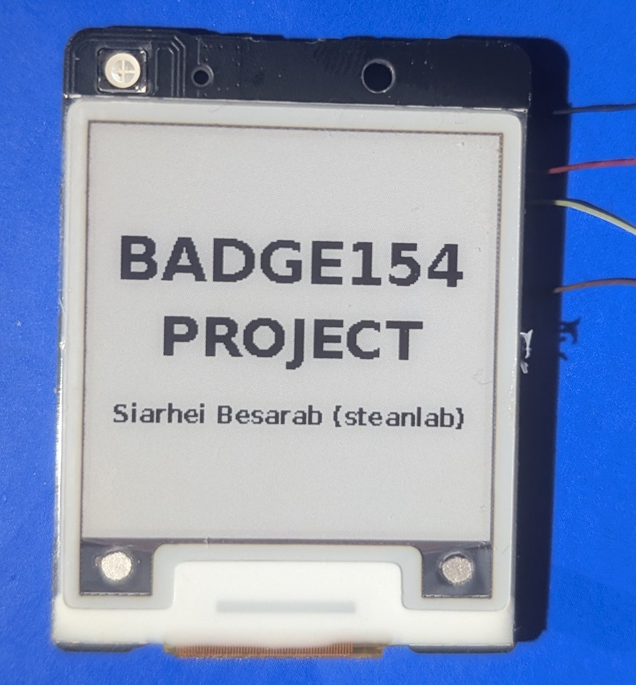

# User guide

badge154 turns the Hanshow Nebular 154 tag (Pro 154Q-N, Plus 154Q-N or 154R-N) into a small e-paper picture frame or name badge. This guide explains what the tag can do and how it behaves.
Flashing the firmware is described in [`../firmware/FLASHING.md`](../firmware/FLASHING.md); the technical side is in [`PROTOCOL.md`](PROTOCOL.md) and [`HARDWARE.md`](HARDWARE.md).

## What you need

- the tag with the badge154 firmware and a battery,
- a phone or computer with **Chrome** (Android, Windows, macOS, Linux) and Bluetooth. iPhone: Safari has no Web Bluetooth, so the page cannot talk to the tag,
- the control page: https://steanlab.github.io/badge154/. It can be installed as an app (button **Install app**) and works offline after the first visit.

## First use

1. Start the tag: put the coin cell in (Plus) or restart it (Pro and 154R-N have a soldered cell, see [Restarting the tag](#restarting-the-tag)). The LED blinks blue once and after a moment the **start-up screen** (BADGE154) is drawn. The panel needs about 25 s to redraw; the picture then stays without power.
2. Open the control page, press **Connect** and choose `badge154-...` in the list (if it is missing, tick "show all Bluetooth devices", move closer and wait a few seconds: the tag announces itself once per second).
3. The page shows the firmware version, the battery voltage, the name and the slides on the tag.
4. Choose one or several pictures. Check the preview. **Upload to the tag**. A picture of 5 to 9 KB takes 10 to 15 s.
5. Press **show** next to a slide to see it (the panel refresh takes about 25 s), or set an interval so that the tag changes slides by itself.

## What the tag does

| Function | Description |
|---|---|
| **Slides** | Up to 98 blocks of 4 KB. A flat picture takes one block, a dithered photo one to three. Every slide is checked (CRC) before it becomes visible, so an interrupted upload never leaves a broken picture. |
| **Automatic change** | Every N minutes (0 = off), in order or at random. The timer does not run while a phone is connected. |
| **NFC tap** | Touch the tag with a phone: the next slide is shown. No app is needed. It can be switched off on the page. Ignored while connected, during an upload and during a refresh. |
| **Tag name** | Up to 16 bytes; the Bluetooth list shows `badge154-<name>`. Empty name = `badge154-` and the last three bytes of the tag's address. A new name appears after the next scan. |
| **Hardware report** | Battery, uptime, time to the next change, memory, flash chip, chip and panel temperature, link, radio power, restarts. Also on the tag screen (**Show on the tag screen**: red background, white text). |
| **Radio power** | Advanced: nine levels from +10 to -19 dBm; default +3 dBm. Lower = shorter range. If the connection drops after lowering it, move the tag close and choose a higher level. |
| **Low battery protection** | Below 2.4 V the tag stops writing and redrawing and shows a red "LOW BATTERY" screen. The slides are kept. Normal work resumes above 2.5 V (new battery). |
| **Watchdog** | If the firmware ever hangs, the chip restarts by itself after 8 s. The hardware report counts restarts. |

Slides and settings survive a battery change. The picture on the panel stays when the battery is removed.

## Light signals

The LED is the only indicator besides the screen.

| LED | When | Meaning |
|---|---|---|
| One blue blink | after the battery is inserted or after a restart | the tag has started; the start-up screen follows |
| Brief green flash every 30 s | idle, no phone connected | the tag is alive (the flash is very short: look in dim light) |
| Brief **red** flash every 30 s | idle, no phone connected | battery low |
| Slow fade red - green - blue | a phone is connected | connection is up; stops after 10 minutes of one connection to spare the battery |
| Short blue blink | after a phone touched the tag | NFC tap recognised, the next slide is drawn |
| One green blink, then the redraw | at the start of every panel update | the panel answered normally |
| 1 to 6 red blinks, then the redraw | at the start of a panel update | that many waits for the panel ran into a timeout: the panel is not answering well (weak battery or a bad contact) |

## Screens on the tag

*The start-up screen (the wires are the programming connection used for flashing).*

- **Start-up screen** (BADGE154 PROJECT): drawn at every start. It stays until a phone has connected and disconnected, or until the interval of the slideshow runs out; then the slides begin.
- **Slides**: what you uploaded.
- **TAG HARDWARE**: the report you asked for (red background, white text).
- **LOW BATTERY**: red screen, drawn once.

## The control page

- **Slides on the tag**: show, delete, previous / next, delete all.
- **Slideshow**: interval, order, NFC tap on/off, **Save to tag**.
- **Tag name**.
- **Add pictures**: choose one or many files; the slot is the first free number unless you type one. Fit (fill the screen / whole picture / stretch), rotate, mirror, contrast, gamma, colour strength, sharpening and dithering to the four ink colours or to black and white. Two buttons set a good style in one click: **Photo / illustration** and **Logo / text / flat colours** (see [Pictures](#pictures)). The preview is softened and small on purpose, because the eye merges the dots of the panel (untick *preview like on the tag* to see the single dots). The line under the preview tells how many 4 KB blocks the picture takes.
- **TAG HARDWARE**: the report. The unique ID of the flash chip and the full address are shown only on request and never go to the log.
- **Advanced**: write size, "do not compress", read status, test patterns (colour bands, orientation), radio power, watchdog test (the tag hangs on purpose and restarts after about 8 s), NFC probe (diagnostics).

## Pictures

These choices come from tests on the real panel (subjective, one person, several pictures):

- **Photos and illustrations**: Floyd-Steinberg with the measured ink colours and *mix in linear light* off. This is the default and the **Photo / illustration** button. In the test it looked the most natural on a face; with linear light on the picture looked darker; ordered 8x8 was the darkest and showed a visible mosaic; blue noise was close to Floyd-Steinberg.
- **Logos, text, flat colours**: the **Logo / text / flat colours** button (*nearest colour only*). Floyd-Steinberg puts visible dots into flat areas, and the edges of letters are sharper without it.
- **Drawings with grey areas** (also black and white): use Floyd-Steinberg. With *nearest colour only* whole grey areas disappear.
- **Colours**: the real inks are not what the names say. The red is a brick red-brown and the yellow leans to orange; the page uses values measured on the panel (*Ink colours: measured*). The button *Test pattern: colour bands* in Advanced draws the four inks on the tag.
- A flat picture compresses to one 4 KB block; a dithered photo takes two or three.

## Battery

The tag works from its battery for as long as the interval and the number of redraws allow; the current consumption has not been measured. Every redraw costs energy, so a long interval is gentler. When "LOW BATTERY" appears, the battery has to be replaced (Plus: a new coin cell; Pro and 154R-N: the soldered cell; charging was not examined); nothing is lost.

## Restarting the tag

A restart does not erase slides or settings. Three ways, from the easiest:

- **From the page** (any variant, the tag must be connected): **Advanced → Watchdog test**. The tag hangs on purpose, the connection drops and the tag restarts by itself after about 8 s. The restart counter of the hardware report goes up by one each time, so it no longer shows only real hangs.
- **Plus**: take the coin cell out for 5 to 10 s and put it back.
- **Pro and 154R-N** (soldered cell): touch the **NRST** pad to the **GND** pad for a moment, for example with a wire or the end of a paper clip. The two pads are at the bottom edge of the board, next to each other. The housing has to be opened for this; one possible idea, not tested here, is to drill two small holes in the housing over these pads so that a bent paper clip can be pushed in.
- The LED blinks blue once and the start-up screen follows.
- There is no separate restart button in the firmware. A dedicated restart command could be added later.

## Troubleshooting

- **The tag is not in the list**: tick "show all Bluetooth devices", move closer, wait a few seconds. After lowering the radio power the range is shorter.
- **"GATT operation already in progress" or a failed connect**: press Connect again; the page retries by itself. If it keeps failing, restart the tag ([Restarting the tag](#restarting-the-tag)).
- **A new picture does not appear**: uploading does not redraw the panel; press **show**.
- **The colours look different from the preview**: the page uses colours measured on the panel from photographs, so they are close but not exact, and the real panel also looks different in other light. Keep *preview like on the tag* ticked for a closer match.
- **A new page version does not appear**: the page is kept for offline use; reload it twice.
- **The picture is mirrored or rotated**: use Rotate / Mirror and upload again.
- **Updating the firmware** is possible only by wire (USB-UART adapter); there is no update over Bluetooth.
